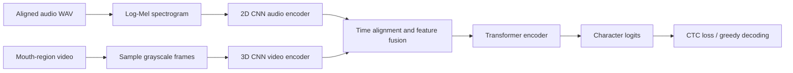

# Audiovisual Speech Recognition

[](https://github.com/Dead-ender/audiovisual-speech-recognition/actions/workflows/ci.yml)


A PyTorch research toolkit for experimenting with character-level audiovisual speech recognition. It pairs log-Mel audio features with grayscale video frames, encodes each stream, fuses them with a Transformer, and predicts text with CTC.

> **Research status:** this repository contains a model implementation and data pipeline, not a trained speech-recognition product. No real audiovisual dataset, pretrained checkpoint, benchmark, or verified accuracy is included. The old notebook uses synthetic data only; its outputs are not recognition results.

## What is included

- Installable `avsr` Python package and command-line interface.
- CSV manifest validation with relative media paths.
- WAV loading, mono conversion, sample-rate resampling, and log-Mel features.
- Uniform video-frame sampling and grayscale resizing from clips that are already cropped to the mouth region.
- Length-aware batching, audiovisual time alignment, Transformer fusion, CTC training, and greedy decoding.
- Checkpoint save/load, CER/WER evaluation, unit tests, and continuous integration.
- Original notebook retained as a small synthetic pipeline walkthrough.
- A model card that states what is and is not evaluated, plus a practical inference guide.

## Architecture



Details and assumptions are documented in [the architecture notes](docs/architecture.md) and [the data format guide](docs/data-format.md).

## Install

Use Python 3.10 or newer. PyTorch and TorchAudio must use compatible builds. For a CUDA or CPU environment, select the matching pair with the [official PyTorch installer](https://pytorch.org/get-started/locally/), then install this project:

```bash
python -m venv .venv
# Activate the environment, then install matching torch and torchaudio builds.
# TorchAudio 2.9+ also uses TorchCodec for audio decoding.
python -m pip install -e ".[dev]"
```

`requirements.txt` provides the same editable development install for tools that use requirements files:

```bash
python -m pip install -r requirements.txt
```

## Prepare data

Create separate training and validation CSV files with these columns:

```csv
audio_path,video_path,transcript
audio/0001.wav,video/0001.mp4,hello world
audio/0002.wav,video/0002.mp4,turn left
```

Relative paths are resolved from the manifest's directory. Each WAV, video, and transcript must describe the same utterance. Video should contain a stable mouth-region crop; this project does not detect faces or crop lips. The default transcript alphabet supports lowercase English letters, spaces, and apostrophes. See the [data guide](docs/data-format.md) before preparing a corpus.

Validate file paths and transcript characters before training:

```bash
avsr validate-manifest data/train.csv
```

## Train and evaluate

```bash
avsr train \
  --train-manifest data/train.csv \
  --validation-manifest data/validation.csv \
  --output checkpoints/avsr.pt \
  --epochs 10 \
  --batch-size 8 \
  --seed 42

avsr evaluate --manifest data/test.csv --checkpoint checkpoints/avsr.pt
avsr predict --manifest data/test.csv --checkpoint checkpoints/avsr.pt --output predictions.json
```

Training logs loss, character error rate (CER), and word error rate (WER); it saves the checkpoint with the best validation CER and a JSON training history. The default model is intended for short, aligned utterances. Transformer self-attention cost grows quickly with sequence length, so split long recordings into utterances before training.

See [the inference guide](docs/inference.md) for command-line and Python prediction examples. The [model card](MODEL_CARD.md) documents the model's status, intended use, and known limitations. No trained checkpoint or measured accuracy is included.

## Notebook

Open `Audiovisual Speech Recognition through Multimodal Fusion of Lip Movements and Audio Spectrograms.ipynb` in Jupyter or Colab for the original model-wiring demo. It creates random audio/video/text examples in memory. It does not use speech or a real lip-reading corpus, so its loss and predictions must not be presented as ASR performance.

## Tests

```bash
python -m pytest
```

Tests cover text encoding, manifest validation, variable-length batching, model/CTC forward and backward passes, checkpoint round-trips, decoding, metrics, notebook structure, and (when TorchAudio/OpenCV media support is available) generated WAV/video through the real loader, model, and decoder. The generated media is only a pipeline smoke test: it contains no speech and must not be used as evidence of recognition quality.

## Data, privacy, and limitations

This repository does not redistribute audio, video, participant data, checkpoints, or generated predictions. Use only audiovisual data that you have permission to process. Voice and face recordings can be identifying biometric data; obtain appropriate consent and follow the dataset's license and privacy rules.

The default implementation is an educational baseline. It has no speaker-independent evaluation protocol, production preprocessing, beam-search decoder, pretrained weights, or evidence of real-world accuracy. Results depend on the dataset, alignment, speaker split, and training setup. See [CONTRIBUTING.md](CONTRIBUTING.md) for development guidance.
